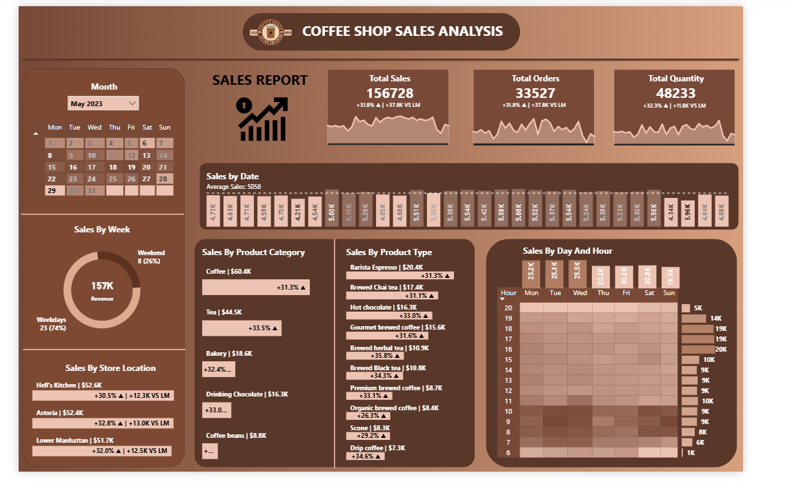

# Coffee Shop Sales Analysis (Power BI)

An interactive Power BI dashboard analysing **149,116 transactions** from a three-store coffee chain in New York (January–June 2023). It shows when, where and what customers buy, to help with staffing, inventory and promotions.

---

## Key findings

| Finding | Number |
|---|---|
| Total revenue (Jan–Jun 2023) | **$698,812** from 214,470 items sold |
| Revenue growth, January → June | **+103.8%**, with the biggest jumps in March (+29.8% MoM) and May (+31.8% MoM) |
| Morning rush (7–10am) share of revenue | **45.8%**, peaking at 10am |
| Top category | **Coffee, 38.6%** of revenue, then Tea at 28.1% |
| Best-selling product type | **Barista Espresso** ($91.4K), then Brewed Chai ($77.1K) and Hot Chocolate ($72.4K) |
| Store split | Very even: Hell's Kitchen 33.8%, Astoria 33.2%, Lower Manhattan 32.9% |
| Weekend effect | None: weekends are 28.2% of trading days and bring 27.9% of revenue |

**What this means for the business**
- **Staff for the morning.** Almost half of revenue lands in four hours, so the 7–10am shift is where extra staff and faster service pay off most.
- **Lift the afternoon.** From 11am onwards each hour brings in only 4–7% of revenue, about half a peak-morning hour, and there's no weekend lift. Off-peak offers (for example, a bakery item with tea after 3pm) target that spare capacity.
- **Coffee and tea drive two-thirds of sales**, so stock-outs of espresso beans or chai would hurt more than any other category.

*Figures computed from `Coffee Shop Sales.xlsx`; revenue = quantity × unit price.*

## Dashboard features

- **KPI cards:** total sales, total orders and quantity sold, with month-over-month growth
- **Calendar heat map:** daily sales by week and weekday, with a custom tooltip page showing that day's sales, orders, quantity and MoM change
- **Day × hour heat map:** shows the morning rush at a glance
- **Sales by store, product category and product type**
- **Weekday vs weekend split**
- **Month slicer** that drives every visual

## How I built it

- **Power Query:** cleaned and typed the raw data, and added a calculated `Sales` column (quantity × unit price) and an `Hour` column
- **Data model:** a dedicated **Date table** related to transactions, with month-year, week number, day name and weekday/weekend flags
- **DAX measures:** `Total Sales`, and `MOM Growth & Diff Sales` for month-over-month change in the tooltips
- **Design:** custom background, icons and a report-page tooltip for the heat map

## Run it

1. Download `Coffee Sales Analysis.pbix` and `Coffee Shop Sales.xlsx`.
2. Open the `.pbix` in **Power BI Desktop**.
3. If prompted, point the data source at your copy of the Excel file.

## Tech stack

Power BI Desktop · Power Query · DAX · data modelling (Date table) · Excel
